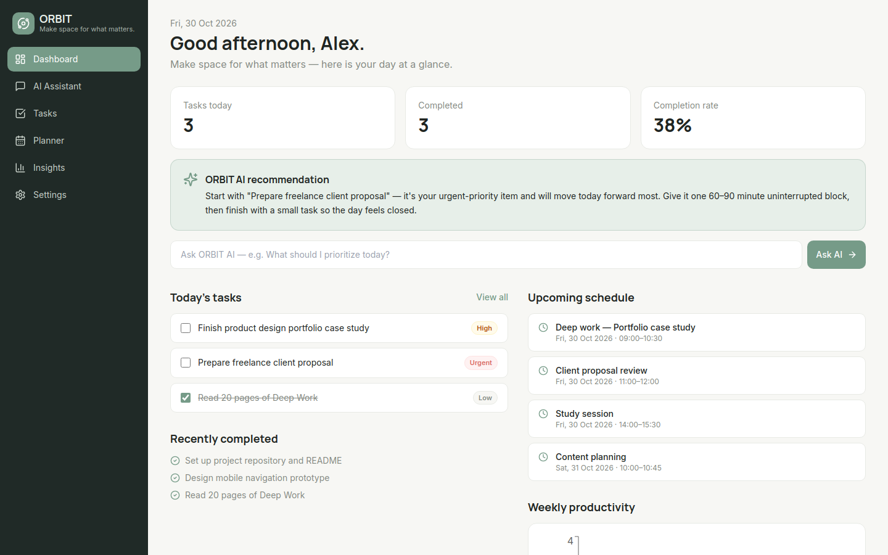

# ORBIT — Make space for what matters

ORBIT is an AI-powered productivity assistant for students, freelancers, developers, content creators, and professionals. It helps you organize tasks, plan realistic days, and think clearly with an intelligent assistant that speaks English and Indonesian.



## Features
- **Dashboard** — greeting, daily summary, today's tasks, upcoming schedule, quick AI input, recently completed, AI daily recommendation, weekly productivity chart
- **AI Assistant (/chat)** — conversations (create / rename / delete), suggested prompts, Markdown + code rendering with copy, retry, copy responses, auto-scroll, Enter to send / Shift+Enter for newline
- **Task Manager (/tasks)** — full CRUD, priorities (Low / Medium / High / Urgent), due dates, categories, search / filter / sort, list + board views, subtasks, and **Break down with AI**
- **Planner (/planner)** — daily + weekly views, time blocks, deadlines, and an AI scheduling assistant you can apply to your day
- **Insights (/insights)** — completed tasks, completion rate, weekly activity, priority distribution, and consistency, all computed from your real task data
- **Settings (/settings)** — profile, appearance (light/dark), language (EN/ID), AI style & creativity, memory on/off + memory CRUD, notification preferences
- **Memory** — persistent preferences per user, inspectable, editable, deletable, and disableable. ORBIT never saves every message as memory.

## Tech stack
Next.js 14 (App Router) · TypeScript · Tailwind CSS · Lucide React · Framer Motion · Recharts · React Hook Form-compatible forms · Zod · Supabase (PostgreSQL + Auth, optional) · OpenAI API (optional, server-side only)

## Getting started
```bash
npm install
cp .env.example .env.local   # optional — demo works with no keys at all
npm run dev                  # http://localhost:3000
npm run build && npm start   # production
```

### Demo mode (no keys required)
With no environment variables, ORBIT runs fully in demo mode: realistic seed data is loaded and persisted to `localStorage`, and AI routes use a built-in rule-based fallback that detects English vs Indonesian and gives specific help with prioritization, task breakdown, day/study planning, and procrastination — never lorem ipsum. Reset anytime in Settings → Account → Reset demo data.

## Environment variables
| Variable | Required | Purpose |
|---|---|---|
| `NEXT_PUBLIC_SUPABASE_URL` | No | Supabase project URL (live auth/sync) |
| `NEXT_PUBLIC_SUPABASE_ANON_KEY` | No | Supabase anon key |
| `SUPABASE_SERVICE_ROLE_KEY` | No | Server-only Supabase key — never expose to the client |
| `OPENAI_API_KEY` | No | Enables live OpenAI responses; server-side only |
| `OPENAI_MODEL` | No | Model name, default `gpt-4o-mini` |

## Database setup (Supabase)
1. Create a Supabase project. 2. Run `supabase/migrations/001_init.sql` in the SQL editor (or `supabase db push`). It creates `profiles, conversations, messages, tasks, subtasks, memories, schedules` with foreign keys, indexes, validation, and Row Level Security so every user can only access their own records. 3. Set the Supabase env vars above and install `@supabase/supabase-js` to switch the client in `lib/supabase.ts` to live mode.

## AI configuration
AI calls happen only in server API routes (`/api/ai/chat`, `/api/ai/breakdown`, `/api/ai/recommend`, `/api/ai/plan`) — keys are never exposed to the frontend. Defaults: temperature 0.7, max tokens 1500, system prompt in `lib/ai/openai.ts`, response style configurable in Settings. Without `OPENAI_API_KEY`, the fallback in `lib/ai/fallback.ts` handles requests.

## Screenshots
See [`screenshots/README.md`](screenshots/README.md) for the 7 required shots (Dashboard, AI Chat, Task Manager, AI Task Breakdown, Planner, Insights, Settings) and how to capture them from the running app.

## Deployment
Deploy on Vercel: import the repo, set the env vars above, and deploy. `npm run build` must pass. No secrets are committed; `.env*` is gitignored except `.env.example`.

## Design
Editorial minimalism: background `#F7F7F4`, surface `#FFFFFF`, primary `#769B88`, text `#202522`, muted `#858A83`, borders `#E8EAE5`. Headings in Manrope, body in Inter, Lucide icons only, 240px collapsible sidebar, dark mode persisted.
